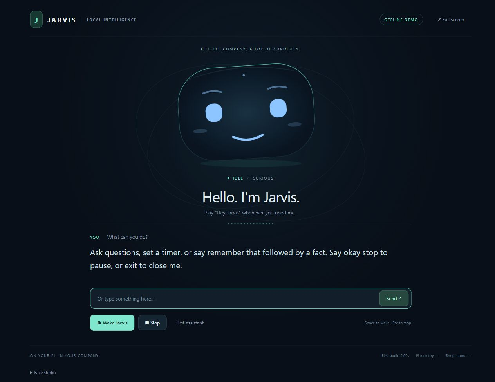

# Jarvis — offline Raspberry Pi voice companion

A headless voice assistant for **Raspberry Pi 4B, 4 GB RAM, 32 GB SD**, a **Plantronics Blackwire 3210 USB headset**, and a laptop browser. All inference and headset audio run on the Pi. The laptop draws the animated face. No Ollama, API keys, cloud speech, CDN assets, or runtime internet connection.



## Five-command Pi setup

Start with **Raspberry Pi OS Lite 64-bit**, Bookworm or Trixie, SSH enabled, a normal user with sudo access, and the headset plugged **into the Pi**. Use a good power supply and active cooling. The installer requires internet once and at least 5 GB free disk space. Compilation on a Pi 4 can take a while; five commands does not mean five minutes.

```bash
git clone https://github.com/ANBU-SELVAN-1907/raspberry-4b-4gb-voice-assistant-live-v1-.git ~/jarvis
cd ~/jarvis
bash scripts/install.sh
bash scripts/configure_audio.sh
bash scripts/service.sh install
```

If the headset cannot be identified uniquely, the audio script prints the cards. Repeat its command with `--card CARD_ID`, using the ID shown in square brackets by `arecord -l`. It stores the stable ALSA ID, so a changed card number after reboot does not change the selected headset.

On your **laptop**, keep this SSH command running:

```bash
ssh -o ExitOnForwardFailure=yes -o ServerAliveInterval=30 -N -L 127.0.0.1:8765:127.0.0.1:8765 YOUR_USER@YOUR_PI_IP
```

Open **[http://127.0.0.1:8765](http://127.0.0.1:8765)** in the laptop browser. Both devices can use a local router without internet. An SSH connection or local network connection is still necessary for the screen; offline means no internet/cloud dependency. No Pi desktop, remote desktop, or forwarded GUI is required.

### If you transfer this complete folder instead of cloning

Copy it to a simple Pi path such as `~/jarvis`. Then run these **on the Pi**:

```bash
cd ~/jarvis
bash scripts/install.sh
bash scripts/configure_audio.sh
bash scripts/service.sh install
```

The installer rebuilds `.venv` for Linux ARM64 and builds the Pi's native llama.cpp binary. A copied Windows virtualenv or test binary is never used for production. Already downloaded portable model files are verified and reused. The laptop can delete its project copy afterward: it only needs an SSH client and browser. It does not host any assistant inference or headset audio.

Windows users can also run `scripts/laptop.ps1 -PiHost YOUR_PI_IP -PiUser YOUR_USER` in PowerShell.

## Talk to Jarvis

1. Say **“Hey Jarvis”**, pause briefly, then ask your question. The face changes to Listening.
2. Jarvis gives a short spoken answer through the Pi's USB headset and returns to idle. Each new spoken question begins with the wake phrase.
3. Say **“okay stop”** or **“stop talking”** during an answer to cancel speech and generation. The browser Stop button and Escape key do the same.
4. Say **“exit”** to stop the assistant service cleanly. This does **not** power off the Pi. Restart with `bash scripts/service.sh start`.

The browser also supports typed questions, a Wake button, Space to wake, and a local Face studio with 14 expression previews.

Useful requests:

- “What time is it?” / “What is the date?”
- “Set a timer for two minutes.” (up to eight timers, at most one day each)
- “Remember that my name is Anbu.”
- “What do you remember about me?”
- “Forget my memory.”
- General questions, brief explanations, friendly conversation, and questions about your own local notes.

Timers run while the service is alive. They are not retained after exit/reboot. A finished timer appears in the GUI; it is spoken if the assistant is idle, without interrupting a current answer.

## Models and why these choices

Verified against official sources on **12 October 2026**. “Best” is a starting engineering choice for this hardware, not a measured claim that it beats every model on your Pi.

| Component | Default | Download size | Reason |
|---|---|---:|---|
| LLM | LiquidAI **LFM2.5-1.2B-Instruct Q4_K_M** | 731 MB | Small edge-oriented instruction model, official GGUF, no reasoning-token delay |
| Wake/control | sherpa-onnx **Zipformer zh-en 3M, 2025-12-20**, int8 chunk-8 | ~5.4 MB inference files | Tiny continuous detector, documented 160 ms model chunk latency |
| English STT | sherpa-onnx **streaming Zipformer en-2023-06-26**, int8 encoder/joiner | ~73 MB inference files | Bounded streaming recognition, one inference thread |
| English TTS | Piper **en_US-lessac-low**, 16 kHz | 63 MB | Natural local speech; one-thread ONNX session; disposable voice worker |
| LLM runtime | **llama.cpp**, CPU build | built on Pi | No Python LLM binding, no container, no Ollama |

The speech model is older because its small, streaming architecture suits the Pi. Newer and larger ASR models are not automatically faster or more accurate for your voice. This English recognizer is trained on LibriSpeech; Indian accents, noise, names, and casual speech need real testing. The default voice is English; multilingual support has not been implemented.

Official sources: [LFM2.5 GGUF](https://huggingface.co/LiquidAI/LFM2.5-1.2B-Instruct-GGUF), [sherpa streaming models](https://k2-fsa.github.io/sherpa/onnx/pretrained_models/online-transducer/zipformer-transducer-models.html), [sherpa keyword detector](https://k2-fsa.github.io/sherpa/onnx/kws/pretrained_models/index.html), [Piper](https://github.com/OHF-Voice/piper1-gpl), [llama.cpp releases](https://github.com/ggml-org/llama.cpp/releases).

### Can Nanbeige4.1 GGUF be used?

Yes, [Nanbeige4.1-3B](https://huggingface.co/Nanbeige/Nanbeige4.1-3B) has llama.cpp-compatible community GGUFs. A commonly published Q4_K_M is approximately 2.3 GB for the weights alone. That leaves too little room for its inference buffers, KV cache, speech models, and the OS under this project's ceiling. Its larger computation also conflicts with low latency on Cortex-A72. It is **not installed or supported by the default memory profile**.

[Qwen3.5-0.8B](https://huggingface.co/Qwen/Qwen3.5-0.8B) is another small model to benchmark later. LFM2.5 is the default here for its edge-oriented design and official compact GGUF. We have not claimed a Pi-specific performance comparison between them.

## Idle memory versus response speed

The default `idle_unload_seconds: 0` releases the LLM and Piper worker after every answer. STT is created when listening and its object is released afterward. The small wake detector, microphone stream, local web server, and some allocator pages remain resident. Wake detection cannot run with zero CPU or zero RAM.

Cold loading from an SD card costs time. Model loading begins as soon as wake is detected, so it overlaps your question. For faster repeated conversations, set `idle_unload_seconds` to **45** in `config.json` and restart the service. This retains the idle LLM for up to 45 seconds; its inference CPU use is idle. Piper still unloads after each answer. Stop always kills the LLM, even in warm mode.

Start with the default, measure on the Pi, then choose the mode. Do not assume sub-second first answers. This small CPU-only system cannot promise ChatGPT-level reasoning, perfect factual knowledge, zero errors, or “ultra low latency” for every question.

## RAM budget: what is enforced

- The systemd service has **MemoryHigh=2.1 GB**, **MemoryMax=2.3 GB**, and **MemorySwapMax=0**. These cover the service and all its child processes, including model pages charged to its cgroup. They use decimal bytes, not GiB.
- The app samples `MemTotal - MemAvailable` once per second and stops heavy workers at **3.2 billion bytes** of estimated system use.
- Context is capped at 2048, generation at 128 tokens, default 96. History, references, audio queues, GUI queues, timers, and speech chunks are bounded.
- The GUI runs entirely on the laptop. No image model or animation frames are generated on the Pi.

**A strict cap on the entire machine is not enforceable by this application.** Other processes, the OS, and sampling intervals can take total use above 3.2 GB. Use Pi OS Lite and avoid unrelated services; validate the actual peak before treating the machine budget as met. The hard service cap may terminate the service if a future dependency uses more memory. Do not raise it to hide failures. Installation/build steps are outside the runtime service cap.

## Add offline knowledge

Place UTF-8 `.txt` or `.md` documents into `data/knowledge`, then run:

```bash
.venv/bin/python scripts/index_knowledge.py
```

Files must be under 1 MB each. Up to 5,000 chunks are indexed locally using SQLite FTS5. This is **keyword retrieval**, with at most two short extracts supplied to the LLM, not semantic search or an internet knowledge update. The GUI shows the matching filenames; an LLM may still misunderstand or hallucinate, so verify important facts. Saved personal facts are explicit and limited to the most recent 20; only 10 are supplied to the model. Transcripts/audio are not recorded during normal operation. Audio tests create sample WAVs in `run/`.

The installer includes a small note about operating this assistant and indexes it automatically. Your own notes can be added alongside it.

## Verify your Pi

Before starting the service, test actual microphone and playback:

```bash
bash scripts/audio_test.sh
```

For model integrity, synthetic speech, latency, and service limits:

```bash
.venv/bin/python scripts/doctor.py --models --verify-hashes
.venv/bin/python scripts/model_smoke.py --llama-binary vendor/llama.cpp/build/bin/llama-server
# Stop the service before a separate benchmark; both use the same server port.
bash scripts/service.sh stop
.venv/bin/python scripts/benchmark.py
bash scripts/service.sh start
bash scripts/acceptance.sh
```

The GUI shows time from a final recognized/typed question to the first audio block submitted for playback. It excludes the wake phrase and utterance duration, and is a software measurement, not an acoustic measurement at the earpiece. `run/benchmark.json` measures LLM cold load, first token, and full generation on the machine running it. It deliberately does not claim full-pipeline peak memory. Follow [hardware acceptance](docs/ACCEPTANCE.md) to record full-system memory, natural speech accuracy, and interruption delay on your actual Pi.

## Manage and troubleshoot

```bash
bash scripts/service.sh status
bash scripts/service.sh logs
bash scripts/service.sh restart
```

Model/worker logs: `run/llama.log`, `run/speech.log`, `run/tts.log`. Installation records exact runtime version information in `run/llama-release.txt`, `run/llama-commit.txt`, and `run/python-versions.txt`. The latest stable llama.cpp release is resolved from GitHub when installing. The verified release during development was **v0.6.0**; use `LLAMA_REF=v0.6.0 bash scripts/install.sh` if a later release changes its interface.

See [setup details](docs/SETUP.md), [architecture](docs/ARCHITECTURE.md), [troubleshooting](docs/TROUBLESHOOTING.md), [validation evidence](docs/VALIDATION.md), and [model/dependency licenses](THIRD_PARTY.md).

## Developer checks and GUI demo

```bash
python -m pip install aiohttp==3.14.5
python -m unittest discover -s tests -v
python -m jarvis.app --mock
```

The mock GUI never loads a model or opens the microphone. It is clearly labeled **OFFLINE DEMO**. It is for interface development, not evidence of Pi speech speed. The production scripts target Linux ARM64; a Windows CPU binary was used only for local API smoke testing.

GitHub Actions runs Python integration tests, Python/JavaScript syntax checks, Bash syntax checks, and ShellCheck. It does not have your Pi or headset and therefore cannot certify hardware latency, cooling, whole-machine RAM, or real microphone accuracy.
