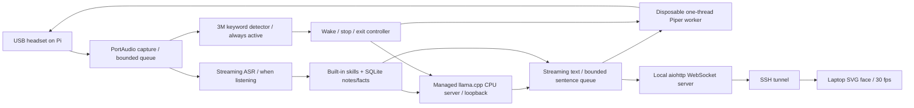

# Architecture

## Processes

- `jarvis.app`: event loop, safe command controller, local HTTP/WS server, SQLite memory/FTS, telemetry, timer tasks.
- `jarvis.speech_worker`: continuous 48 kHz capture; sherpa resamples internally; keyword spotting always runs on one thread. STT is instantiated when listening and decoded only while listening. It receives session IDs so stale final transcripts cannot start a new turn.
- `llama-server`: started on wake, API bound to 127.0.0.1. CPU NEON build for ARMv8-A; three threads leave scheduling room for keyword/audio work. Context 2048; batch128/microbatch64; one slot; no GPU layers.
- `jarvis.tts_worker`: Piper ONNX session with one intra-op/inter-op thread. It emits 2048-byte PCM chunks over NDJSON stdout. The main process writes them to the USB output and sends energy events to the face. The worker exits at the end of each turn or on cancellation.

The LLM and Piper can overlap at sentence boundaries. Queue backpressure prevents text generation from accumulating unbounded synthesized speech. The model may still buffer a few tokens in its HTTP/socket buffers, which are bounded by the OS. The audio thread cannot wait on browser clients; slow clients drop the oldest GUI events.

## Lifecycle

Booting → Idle → Listening → Thinking → Speaking → Idle. Thinking and speaking overlap during a streamed answer. Error is recoverable through a new Wake/typed question after the underlying issue is fixed. Exit shuts down the application and all workers, leaving the OS running.

Stop increments the listening session ID, idles STT, cancels both text and speech tasks, aborts the audio output, terminates Piper, and terminates llama.cpp. Cancellation of the HTTP response alone is insufficient to guarantee inference has stopped, hence process termination. Wake through the GUI during an active answer also cancels that answer.

The voice detector's acoustic delay is additional to application cancellation delay. There is no full acoustic echo cancellation implementation. The intended device is a close-talk headset with earpiece playback; an open room speaker can trigger keywords from Jarvis's own speech and make interruptions unreliable.

## Bounds and complexity

Per 50 ms capture block, neural inference dominates runtime. PCM queue: 24 blocks, at most 1.2 seconds; oldest audio is dropped on overflow to avoid growing latency. Model decoding during STT is greedy. Text chunks: about 160 characters; sentence queue: two entries. GUI clients: four, each queue16; WS message max2048 bytes. Input: 600 characters. Conversation: four messages, each stored at most 400 characters. Generation: default96 tokens; hard configuration max128. Timers: eight. Facts:20 saved /10 supplied. Reference prompt:1800 characters. Knowledge:5000 chunks, two 600-character results. Retrieval uses SQLite's FTS index rather than scanning all documents per query.

## Offline boundary

Runtime uses no model hub or download APIs. Model paths are local and llama.cpp is built with CURL disabled. Python HTTP clients do not inherit proxy environment settings. Browser resources are served from local files. The systemd service additionally restricts network access to loopback using `IPAddressDeny=any` / `IPAddressAllow=localhost` where the kernel/systemd supports that filtering. SSH forwarding is supplied by sshd outside the assistant service. Read the journal for unsupported filtering warnings; application offline operation does not depend on the filter.

No LLM response is executed as a command. Built-in functions are selected from exact user commands; retrieved text is treated as reference data. GUI command WebSockets require a same-origin header and loopback binding. This is intended for a single trusted laptop user through SSH, not public hosting.

## Facial behavior

SVG paths scale to 4K without bitmap videos. Laptop-side requestAnimationFrame updates eyes, eyebrows, gaze, blinking, head tilt, mouth, and a waveform at30 fps. Background tabs pause animation work, and reduced-motion preferences reduce head/gaze motion. PCM RMS drives mouth opening; it is energy synchronization rather than phoneme-level lip sync. Emotion is a small deterministic text heuristic, not an emotion-recognition model. Face studio previews all14 supported visual styles locally; automatic text mapping uses a subset.
