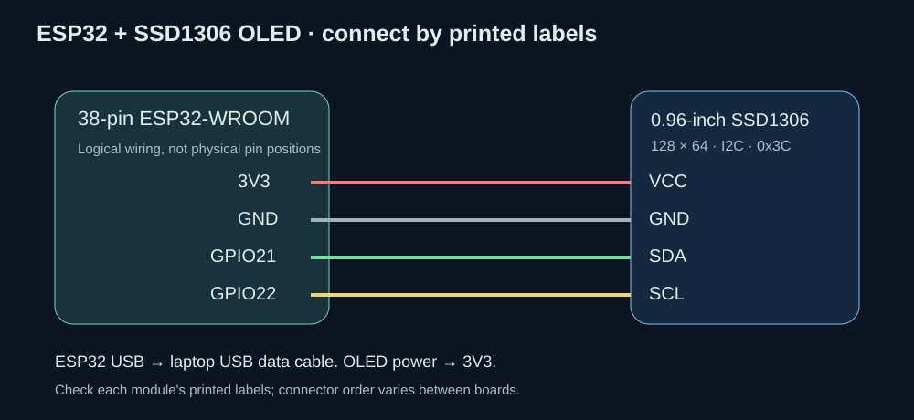

# Jarvis complete project guide

Windows laptop voice companion with an ESP32 OLED display  
Project documentation • 12 October 2026

## 1. What this project does

Jarvis is an English voice assistant that runs locally on a Windows 10/11 x64 laptop. It listens for **Hey Jarvis**, understands a spoken question, generates a short answer, speaks through your headset, animates a face in the laptop browser, and sends the answer to an optional ESP32 OLED. Normal use requires no internet, AI account, API key or subscription.

The current target is an **Intel i7 12th-generation laptop with 16 GB RAM**. A comparable Windows x64 computer can also work. The laptop performs all AI computation. The ESP32 handles only the small text display. The Raspberry Pi implementation remains in the repository for historical reference; this guide covers the Windows version.

The assistant includes short conversation history, explicitly saved personal facts, local text-note search, timers, local time/date, interruption, clean exit, device configuration, diagnostics, and an animated interface. It does not browse the internet, execute arbitrary computer commands, train itself, or control home appliances.

The project repository is [raspberry-4b-4gb-voice-assistant-live-v1-](https://github.com/ANBU-SELVAN-1907/raspberry-4b-4gb-voice-assistant-live-v1-). Its historical name does not change the current Windows target.

### Read this guide in this order

1. Sections 2–5: hardware, transfer, installation and OLED wiring.
2. Sections 6–9: commands and how the software works.
3. Sections 10–13: memory, notes, settings and project files.
4. Sections 14–19: testing, troubleshooting, applications and maintenance.

## 2. Hardware and software requirements

| Item | Purpose and requirement |
|---|---|
| Windows laptop | Windows 10/11 **x64**, approximately i7 12th-generation performance, 16 GB RAM |
| Writable local folder | Keep the complete extracted project together, for example `C:\Jarvis` |
| Free physical RAM | Maintain at least 1.5 GB available during use; more headroom improves reliability |
| Free storage | Allow several GB for extraction, models and updates; compiling firmware from source requires additional SDK space |
| Plantronics Blackwire 3210 | USB microphone and headset speaker; another supported Windows audio device is also possible |
| Modern browser | Shows the local face and controls; no externally hosted scripts or fonts |
| Classic ESP32-WROOM 38-pin board | Optional USB-connected display controller; confirm printed labels and actual chip family |
| SSD1306 OLED | Optional **0.96-inch, 128×64, four-pin I²C**, normally address `0x3C` |
| USB data cable | Connects the ESP32 to the laptop; a charging-only cable cannot carry serial data |
| Four jumper wires | OLED power, ground, data and clock |
| USB bridge driver | The ESP32 must appear as a COM port in Windows Device Manager |

No dedicated graphics card is required. The LLM uses CPU inference. The browser handles face rendering independently of inference. A 16 GB sticker describes installed capacity, not the RAM available after Windows and other programs start.

## 3. Transfer and first startup

### A. Use the prepared portable bundle

This is the simplest route for your friend's laptop.

1. Transfer **Jarvis-Windows-Portable.zip** and extract it completely. Open the extracted `Jarvis` folder. Do not run the program inside the ZIP.
2. Put the folder in a writable local location. Keep `runtime`, `models`, `vendor`, `jarvis`, `scripts` and `web` together. Do not copy just `start.bat`.
3. Plug in the headset. In Windows Sound settings, choose it for both input and output. Enable microphone access for desktop applications in Windows privacy settings. Check the physical mute control and volume.
4. Run **configure_audio.bat** if you want an explicit microphone/speaker selection. Prefer compatible Windows WASAPI entries. Press Enter at both prompts to use Windows defaults.
5. Double-click **start.bat**. The local browser interface opens at `http://127.0.0.1:8765`. Keep its terminal window open.

Once the interface says it is ready, say **Hey Jarvis**, pause briefly, and ask **What time is it?** Then try a general question such as **Explain gravity in one short sentence**.

The prepared folder includes portable Python, dependencies, speech models, GGUF weights, llama.cpp binaries, compiled ESP32 firmware and a native flasher. It needs no separately installed Python, Git, Ollama, Docker or SSH. A new laptop may still need the correct ESP32 USB bridge driver installed once.

### B. Start from GitHub source only

GitHub does not contain the large downloaded runtime and model assets. A source checkout or **Jarvis-Windows-Source.zip** needs a one-time internet setup.

Open Command Prompt in the extracted project folder and run:

```bat
setup.bat
configure_audio.bat
start.bat
```

`setup.bat` downloads the portable runtime and dependencies, obtains missing official llama.cpp binaries, verifies/downloads the pinned models, indexes starter notes and runs checks. After successful setup, normal operation is offline. Firmware setup is separate if the board has never been flashed.

### C. Apply a small update to an existing prepared folder

For a supplied **Jarvis-Memory-Fix.zip**, first exit Jarvis, then extract the ZIP **over the existing project root**, replacing matching source files. Its `jarvis` directory must merge with the existing `jarvis` directory; avoid creating an extra nested folder. It does not contain models or Python.

Run **repair_memory.bat**, then **start.bat**. The repair preserves audio/OLED settings, backs up the original laptop config, and prints actual physical memory readings. Copying source files alone does not override an existing `config.laptop.json`.

## 4. ESP32 and OLED wiring

Disconnect the board from USB while wiring. Use the printed **signal labels**, because 38-pin clones can have different physical arrangements.

| OLED label | ESP32 label | Function |
|---|---|---|
| VCC / VDD | **3V3** | 3.3 V power |
| GND | **GND** | Common ground |
| SDA | **IO21 / GPIO21 / 21** | I²C data |
| SCL / SCK | **IO22 / GPIO22 / 22** | I²C clock |

Power this OLED from **3V3**. Check each OLED connector label rather than assuming its connector order. Connect the ESP32's USB connector to the laptop with a data cable. No laptop RX/TX jumper wires are needed; the onboard USB serial bridge carries the messages.



### Common 38-pin DevKitC reference

This table follows Espressif's DevKitC V4 J2/J3 numbering. It is a reference, not a promise that your clone has the same physical orientation. Only the four OLED signals above are used by this project.

| Header position | J2 label | J3 label |
|---:|---|---|
| 1 | 3V3 | GND |
| 2 | EN | IO23 |
| 3 | VP / GPIO36 | **IO22 — OLED SCL** |
| 4 | VN / GPIO39 | TX / GPIO1 |
| 5 | IO34 | RX / GPIO3 |
| 6 | IO35 | **IO21 — OLED SDA** |
| 7 | IO32 | GND |
| 8 | IO33 | IO19 |
| 9 | IO25 | IO18 |
| 10 | IO26 | IO5 |
| 11 | IO27 | IO17 |
| 12 | IO14 | IO16 |
| 13 | IO12 | IO4 |
| 14 | GND | IO0 / BOOT |
| 15 | IO13 | IO2 |
| 16 | D2 / GPIO9 | IO15 |
| 17 | D3 / GPIO10 | D1 / GPIO8 |
| 18 | CMD / GPIO11 | D0 / GPIO7 |
| 19 | 5V | CLK / GPIO6 |

EN resets the board. GPIO36/39/34/35 are input-only. GPIO6–11 are associated with module flash and should be left alone. IO0 is used for BOOT during uploading. Pin count alone does not establish whether the board is a classic ESP32, S3 or C3.

Reference: [Espressif DevKitC V4 user guide](https://docs.espressif.com/projects/esp-dev-kits/en/latest/esp32/esp32-devkitc/user_guide.html). The separate [pinout guide](../esp32/PINOUT.md) contains the same connection reference.

## 5. Flash and test the OLED

1. Connect the wired ESP32. Find its COM port under **Device Manager → Ports**.
2. Close Jarvis and Arduino Serial Monitor so neither holds the port open.
3. Double-click **flash_esp32.bat** and enter the correct port, for example `COM5`.
4. If uploading stays at Connecting, hold BOOT until writing begins. Release it when flashing starts.
5. Run **test_oled.bat** while Jarvis is still closed. It sends a long sample to check wrapping and automatic scrolling.
6. Close the test, run **start.bat**, and ask a question. The same answer should appear in the browser and on the OLED.

The supplied image targets **classic ESP32-WROOM** and SSD1306 at `0x3C`. SH1106 panels, SPI displays and ESP32-S3/C3 require different firmware choices. An OLED at `0x3D` needs a source change and firmware rebuild. Check the actual display controller before changing anything.

The prepared bundle can flash the supplied merged binary with its native esptool. It does not require Arduino IDE or the full compiler SDK on the receiving laptop. If the compiled image is missing, the firmware setup script uses Arduino CLI and the classic ESP32 Arduino **2.0.17** core to build it. That fallback needs internet and additional disk space.

Flash once: moving the same ESP32 to another laptop does not require reflashing. Its COM number or USB driver availability may change.

## 6. Everyday commands

| Say or do | Result |
|---|---|
| **Hey Jarvis**, pause, ask a question | Starts one listening session |
| **Okay stop** or **Stop talking** | Cancels generation and playback, unloads heavy workers, returns to idle |
| **Exit** | Closes Jarvis and its workers; Windows and ESP32 remain powered |
| Browser Wake / Space | Starts listening; Space shortcut applies outside text input |
| Browser Stop / Escape | Stops the current response; Escape shortcut applies outside text input |
| Type a question and submit | Sends a question without speaking a wake phrase |
| **What time is it?** | Reads the laptop's local clock |
| **What is the date?** | Reads the laptop's local date |
| **Set a timer for two minutes** | Starts an in-memory timer |
| **Remember that my name is Anbu** | Saves an explicit fact locally |
| **What do you remember about me?** | Lists recent saved facts |
| **Forget my memory** | Deletes saved facts; indexed notes are preserved |
| **Help** / **What can you do?** | Explains basic capabilities |

Each new spoken question requires the wake phrase again. Speak close to the headset microphone, give a small pause after the wake phrase, and wait for the listening state. If a wake phrase is missed, use the browser Wake button.

The always-listening keyword model handles wake, stop and exit. Other spoken commands need a normal listening session first. Exact typed controls are distinguished from normal questions: a sentence containing the word “stop” is not automatically a stop command.

Timers accept seconds, minutes or hours and common small spoken numbers. They support at most eight concurrent timers, with each duration capped at 24 hours. They are lost when Jarvis exits. A completed timer produces a browser event; its spoken announcement waits for an idle state rather than interrupting an answer.

## 7. Software and models used

| Component | Selected technology | What it does |
|---|---|---|
| Language model | **LiquidAI LFM2.5-1.2B-Instruct, Q4_K_M GGUF**, about 731 MB | Generates conversational answers |
| LLM runtime | **llama.cpp**, native Windows x64 CPU server | Loads the GGUF and streams generated text |
| Keyword spotting | **sherpa-onnx 3M zh/en Zipformer, int8**, 2025-12-20 model | Detects wake, stop and exit with compact always-on inference |
| Speech recognition | **sherpa-onnx streaming English Zipformer**, en-2023-06-26, about 73 MB inference files | Converts the spoken question into text |
| Speech synthesis | **Piper en_US-lessac-low**, about 63 MB ONNX weights | Converts reply chunks into 16 kHz English speech |
| Python runtime | Portable **Python 3.13.16 x64** in the prepared bundle | Runs orchestration, audio workers, storage and display bridge |
| HTTP and events | **aiohttp** and browser WebSocket | Serves the local GUI and streams state/text events |
| Audio I/O | **sounddevice / PortAudio**, NumPy | Captures microphone audio and plays synthesized PCM |
| Storage and note search | **SQLite / FTS5** | Saves facts and retrieves matching local note excerpts |
| ESP32 connection | **pyserial**, newline-delimited JSON | Sends display snapshots and checks the firmware handshake |
| OLED firmware | Arduino ESP32, Adafruit SSD1306/GFX, ArduinoJson | Wraps, clips, draws and scrolls display text |
| Face | Local HTML/CSS/JavaScript and SVG | Animates expressions, blinking, gaze and mouth motion |

### Why these choices

The compact 1.2B model balances offline capability against CPU response time and storage. Quantization reduces weight size. The project uses this tested GGUF, not Nanbeige 4.1. Larger models can improve some answers but demand more RAM and CPU time; they cannot be called the fastest option without measurements on the actual laptop.

The streaming speech recognizer begins processing before the user finishes speaking. The small keyword detector avoids keeping the language model active simply to hear a wake phrase. Piper supplies local neural speech without a network connection. Keyword note retrieval adds relevant local information without loading an embedding model.

The installer obtains missing official llama.cpp binaries and records their release information in `runtime/llama-version.json`. Prepared binaries are reused rather than downloaded on every start. The exact release in that file describes your installed bundle; it is not a claim that it will always remain the newest upstream release.

### Useful terms

**STT** means speech to text. **TTS** means text to speech. **KWS** means keyword spotting. **LLM** means large language model. **GGUF** is the file format loaded by llama.cpp. **Q4_K_M** describes the chosen quantization scheme. **Tokens** are pieces of generated text, not necessarily whole words. **Context** is the model's processing window. **PCM** is the raw audio format sent to playback. **FTS5** is SQLite's keyword-search facility. **I²C** is the two-signal bus between ESP32 and OLED.

## 8. Architecture and one complete question

```text
USB headset microphone
        |
        v
Speech worker: keyword detector -> listening STT
        | wake / transcript / stop / exit events
        v
Python assistant coordinator
        |-- local skills: time, date, facts, timers
        |-- SQLite: saved facts + matching note excerpts
        |-- llama.cpp CPU worker: generated text stream
        |
        +--> reply events --> local browser text + animated face
        +--> text chunks --> Piper worker --> USB headset speaker
        +--> latest display snapshot --> USB serial --> ESP32 --> OLED
```

### What happens when you ask a question

1. In idle, the microphone and small keyword detector remain active. LLM and Piper are initially unloaded.
2. “Hey Jarvis” starts a listening session. The recognizer collects your question. LLM loading and retained-voice preloading can overlap your speech.
3. Streaming recognition shows partial text. Trailing silence ends the utterance and submits the final transcript.
4. The coordinator checks stop/exit commands and memory headroom. It retrieves local note excerpts and selects a built-in reply when appropriate.
5. For a general question, llama.cpp receives the system instructions, recent conversation, saved facts, note references and current question. It streams text tokens.
6. The browser receives the growing text immediately. A chunker collects a sentence or suitable clause. Piper speaks chunks while generation continues.
7. Actual audio energy drives mouth movement. Text and state snapshots go to the OLED independently.
8. The completed answer is retained in short conversation history. Jarvis returns to idle. Warm workers can remain resident for the configured window.

States are **booting**, **idle**, **listening**, **thinking**, **speaking**, **error** and **offline**. Generation and speech can overlap even though the GUI presents one main state at a time.

### Stop and exit behavior

Stop cancels the active generation/speech tasks, aborts playback and terminates the LLM/Piper workers. A changed session identifier prevents an old recognizer result from becoming a new reply. Killing the LLM worker also avoids leaving computation running after the HTTP stream is cancelled.

Exit performs cleanup and ends the assistant. It does not shut down the operating system. Prefer Exit or Ctrl+C to abruptly closing the terminal. Closing only the browser does not stop the assistant.

## 9. Face animation and OLED behavior

### Laptop face

The face is an SVG design that scales to a 4K screen without a large video asset. Its browser animation loop runs at approximately 30 fps and pauses when the page is hidden. Blinking, gaze movement, head motion and a waveform create a responsive display. Reduced-motion preferences are supported.

Fourteen expression palettes are available: neutral, happy, curious, sad, surprised, concerned, excited, calm, confused, playful, angry, sleepy, love and scared. Automatic expression selection uses text rules and assistant state. It does not detect your emotional state or understand every emotion scientifically. The mouth follows speech energy rather than individual phonemes.

Browser work is separated from inference. Rendering still consumes some CPU/GPU resources; 4K output is not free, but no 4K video needs decoding or loading into the AI process.

### OLED text layout

The display is physically small, so it shows readable text rather than the laptop face. A fixed header shows status. The answer body begins below it and is drawn into a clipped canvas to avoid covering the header. The standard font allows about **21 characters per line** and about five visible body lines.

Long replies wrap across lines and scroll vertically, approximately one pixel every 45 ms. The firmware pauses at the top and bottom, then repeats. Drawing is refreshed on a separate frame schedule. Appended text preserves scroll progress; a new answer resets it.

The bridge keeps only the latest snapshot, avoiding an unbounded token backlog. It sends changed snapshots at up to five per second and periodically checks acknowledgments. The firmware handshake is `JARVIS_OLED_READY v1`. Auto mode probes supported USB serial identifiers but sends answers only after the expected firmware confirms itself.

The serial protocol is versioned JSON with session, sequence, state and text fields, followed by one newline. Text is bounded to 2,400 characters and normalized to ASCII. Accents and common punctuation are simplified; unsupported scripts become `?`. The current font does not render Tamil or other non-ASCII scripts.

Unplugging the OLED does not stop voice assistance. The bridge reconnects in the background. Wi-Fi and Bluetooth are not used by the display firmware.

## 10. RAM policy and the heavy-workers-stopped warning

Installed memory and available memory are different. Windows, browser tabs, graphics reservations and background applications share the physical RAM. The guard checks **whole-system physical memory**, not just Jarvis.

The updated laptop defaults are:

| Setting | Value | Meaning |
|---|---:|---|
| `system_ram_limit_bytes` | `16000000000` | Stop heavy workers if estimated system use reaches 16 decimal GB |
| `minimum_available_memory_bytes` | `1500000000` | Stop heavy workers if less than 1.5 decimal GB physical RAM remains available |
| Recovery margin | 256 MB | Require extra headroom before automatically clearing a memory-pressure error |
| Monitor interval | About one second | Check repeatedly while Jarvis runs |

These are sampled application safeguards, not a hard operating-system memory cap. Transient usage can occur between checks. The legacy Pi profile retains its separate 3.2 GB system-use budget.

### If you see the warning

1. Exit Jarvis.
2. Run **repair_memory.bat** in the current project folder.
3. Read the printed **total**, **used** and **available** physical memory numbers and the configured thresholds.
4. Run **start.bat** again. If available memory remains below 1.5 GB, close memory-heavy applications.

The repair tool changes only the two laptop memory settings, leaving microphone, speaker, COM port and other preferences intact. It saves the first original config beside the file as `config.laptop.json.before-memory-repair`.

If Task Manager shows approximately **12 GB used out of 16 GB**, the current compact setup would normally have sufficient headroom at that instant. An old low threshold, a temporary spike or a different interpretation of the displayed number can explain the warning; the repair report provides the actual readings. Updating example defaults alone does not change an existing local config.

### Standby and speed tradeoff

Listening for a wake phrase always consumes some CPU/RAM. Zero-resource standby cannot detect speech. By default, LLM and Piper may stay loaded for **300 seconds after a reply** so follow-up turns avoid repeated loading. Low CPU activity does not mean zero RAM residency.

For lower idle memory, use a shorter `idle_unload_seconds` value and set `retain_voice` to false. Setting the idle window to zero unloads the LLM after a turn; Piper also needs `retain_voice: false` for immediate per-turn unloading. Cold responses then take longer. Stop always unloads both heavy workers regardless of the warm setting.

## 11. Local memory and your own knowledge

### Saved facts

“Remember that ...” stores a fact in `data/memory.sqlite3`. Up to 20 recent facts are retained, each bounded to 300 characters. Up to 10 are recalled/provided as references. Explicit facts survive restarting the application.

“Forget my memory” deletes the saved-facts table contents. It does not delete indexed knowledge or clear the short conversation history already in RAM. Restart Jarvis to clear that conversation history.

The recent conversation contains the last four messages, approximately two user/assistant turns, with bounded text. It is context for conversation, not unlimited long-term memory or a complete chat archive.

### Add text notes

1. Stop Jarvis.
2. Create `data\knowledge` if it is missing.
3. Add UTF-8 `.txt` or `.md` files directly inside that directory.
4. From the project root, run:

```bat
runtime\python\python.exe scripts\index_knowledge.py
```

5. Start Jarvis and ask a question containing useful words from your notes.

Example note:

```text
Project name: Desk Companion
The OLED uses GPIO21 for SDA and GPIO22 for SCL.
To configure the headset, run configure_audio.bat.
```

Ask **Which pins does the OLED use?** The matching note can supplement the model's answer. Source filenames appear in the browser.

Indexing replaces the knowledge index with current files. Files must be no larger than 1 MB. Subdirectories are not recursively scanned. Text is split into overlapping chunks, capped at 5,000 chunks total. Search retrieves at most two matching excerpts using SQLite keywords. It does not use semantic embeddings, automatically read PDF/Word files, fetch websites or retrain the LLM. Export such documents to supported plain text first.

Deleting a note requires reindexing to remove its old indexed contents. Back up the database before replacing a populated project folder.

## 12. Configuration reference

Edit **config.laptop.json** in the project root while Jarvis is stopped. Omitted keys inherit defaults from **config.laptop.example.json**. JSON must use double quotes and have no comments or trailing commas. On Windows, the legacy `config.json` is not the normal laptop settings file.

| Key | Default | Purpose |
|---|---|---|
| `host` | `127.0.0.1` | Loopback GUI address |
| `port` / `llama_port` | `8765` / `8766` | Separate GUI and LLM ports |
| `input_device` / `output_device` | `null` / `null` | Follow Windows default devices; audio setup can save names plus host API |
| `input_rate` | `48000` | Mono microphone sample rate; use a rate supported by the headset |
| `threads` | `6` | LLM CPU threads; laptop permits 1–12 |
| `context` | `4096` | LLM context capacity; laptop permits 512–8192 |
| `max_tokens` | `128` | Response generation limit; permitted range 16–256 |
| `idle_unload_seconds` | `300` | Warm-worker idle timeout |
| `retain_voice` | `true` | Keep Piper resident within the warm window |
| `listen_timeout_seconds` | `12` | Listening timeout |
| `utterance_limit_seconds` | `30` | Maximum laptop utterance duration |
| `endpoint_silence_seconds` | `0.65` | Trailing-silence threshold used to finish a question |
| `kws_score` / `kws_threshold` | `2.0` / `0.2` | Keyword detection sensitivity parameters |
| `system_ram_limit_bytes` | `16000000000` | Total system-use guard |
| `minimum_available_memory_bytes` | `1500000000` | Available physical-memory reserve |
| `oled_enabled` | `true` | Enable optional serial display bridge |
| `oled_port` | `auto` | Discover the flashed board, or specify a COM port |
| `oled_baud` | `115200` | Must match firmware serial speed |
| `mock` | `false` | Demo mode without AI/audio models |

The default model paths are `models/llm/assistant.gguf` and `models/tts/en_US-lessac-low.onnx`. The LLM executable is `vendor/windows/llama-server.exe`; keep its DLLs beside it.

More CPU threads are not automatically faster. Benchmark the target laptop. Shorter silence can reduce perceived delay but can cut off pauses. Longer answers take more time to generate, synthesize and scroll. If false wake events occur, try a modest keyword threshold increase, such as 0.3, and retest actual speech.

Do not change a port to match the other port. The GUI binds to loopback and is designed for the local browser, not public hosting.

## 13. Files and responsibility map

| File or directory | Responsibility |
|---|---|
| `start.bat` | Sets the laptop environment and starts the local launcher |
| `setup.bat` / `scripts/setup_windows.ps1` | Installs/repairs the portable runtime and assets |
| `configure_audio.bat` / `scripts/windows_audio.py` | Lists and saves microphone/speaker choices |
| `diagnostics.bat` / `scripts/doctor.py` | Checks configuration, dependencies, models and hashes |
| `repair_memory.bat` / `scripts/windows_memory.py` | Reports RAM and repairs laptop thresholds |
| `flash_esp32.bat` | Runs firmware upload for the selected COM port |
| `test_oled.bat` / `scripts/test_oled.py` | Tests scrolling text without loading AI |
| `scripts/launch_windows.py` | Opens the local browser, detects an already-running instance, launches the application |
| `jarvis/app.py` | Coordinates state, turns, tasks, GUI events, timers and memory maintenance |
| `jarvis/engine.py` | Starts/stops llama.cpp and reads streamed completions |
| `jarvis/speech_worker.py` | Captures audio and runs keyword/streaming recognition in a worker process |
| `jarvis/speaker.py` / `jarvis/tts_worker.py` | Manage speech synthesis and audio playback |
| `jarvis/voice.py` / `jarvis/resample.py` | Load Piper with bounded threading; adapt PCM to supported output rate |
| `jarvis/text.py` | Exact control parsing, expression rules and speech chunking |
| `jarvis/skills.py` | Time/date, saved-fact commands and timer parsing |
| `jarvis/store.py` | SQLite facts and FTS5 note indexing/search |
| `jarvis/metrics.py` / `jarvis/config.py` | System-memory readings, guard policy and validated settings |
| `jarvis/oled.py` | Bounded display snapshots, serial discovery, handshake and reconnect |
| `web/` | Local page, styles, SVG face and event-driven animation |
| `esp32/jarvis_oled/` / `esp32/text_layout.h` | Display firmware and bounded wrapping logic |
| `esp32/build/` | Prepared firmware binaries and manifest; generated, excluded from Git |
| `models/` | Downloaded inference assets and installed checksums |
| `models.lock.json` | Pinned model sources/revisions and download verification metadata |
| `runtime/python/` | Portable interpreter and installed packages |
| `runtime/flasher/` | Native ESP32 upload tool |
| `vendor/windows/` | llama.cpp executable and DLLs |
| `runtime/setup-complete.json` | Marker that prepared setup completed |
| `runtime/runtime-checksums.json` | Hashes of prepared runtime binaries |
| `data/` | Local database and your knowledge files |
| `run/` | Logs and generated validation/benchmark reports |
| `tests/` | Unit and asynchronous integration tests |
| `docs/` | This manual, Windows setup/validation and legacy Pi references |
| `.github/workflows/check.yml` | Automated Windows/Linux source checks |
| `THIRD_PARTY.md` / `LICENSE` | Upstream asset terms and project code license |

Portable runtime paths are relative. The full directory can move to another laptop. Local config, personal database, recordings and logs are excluded from the clean prepared transfer ZIP. A direct copy of your working folder can contain those personal files, so inspect it before sharing.

## 14. Performance and reliability design

The design reduces overhead through a compact quantized LLM, streaming STT, one LLM request at a time, CPU thread limits, short replies, chunked speech, asynchronous coordination and warm-worker reuse. Model/speech workers are separate from the web event loop so a computation does not directly block browser event handling.

Queues and stored context are bounded. The speech-chunk queue holds two chunks. Slow GUI clients cannot build an unlimited backlog. OLED updates coalesce into one current snapshot. Input questions are bounded to 600 characters and display replies to 2,400 characters.

The microphone normally captures 48 kHz mono. sherpa handles internal resampling for recognition. Piper generates 16 kHz mono PCM. If the output device cannot play that rate directly, the speaker uses continuous linear interpolation to the device's supported default rate. This is a lightweight rate conversion, not a high-order studio resampler.

The headset reduces feedback. There is no acoustic echo-cancellation engine; a loud room speaker may feed the assistant's own voice into the detector. Thermal throttling, battery power mode, device drivers and background load affect latency.

## 15. Validation and what remains to test

The updated source suite has **27 passing tests**, including interruption, bounded history, worker-failure cancellation, WebSocket controls, facts/notes, timers, memory guards and recovery, config preservation, OLED framing and audio resampling continuity.

Earlier real-asset checks verified keyword recognition, streaming speech transcription, a real llama.cpp reply, Piper PCM production and local Windows microphone/playback operation. The firmware compiled for classic ESP32; its recorded build used about 300,489 bytes of flash and 38,240 bytes of static RAM. A relocated portable runtime imported its native packages from a different directory containing spaces.

A local typed-query test measured first audio submission at approximately **5.89 seconds cold** and **1.68 seconds on the next warm turn**. These are observations on the development computer, not guaranteed timings on your friend's laptop. They exclude your utterance duration and do not measure sound reaching your ear. A spoken wake can overlap model loading with the question.

Physical ESP32 upload, display wiring/address, visible scroll behavior and Plantronics performance on the receiving laptop must be checked on that hardware. Compilation and software tests cannot establish those physical results. The reported memory warning also requires the receiving laptop's actual readings to establish its exact cause.

### Checks you can run

With Jarvis stopped, from the project root:

```bat
diagnostics.bat
runtime\python\python.exe -m unittest discover -s tests -v
runtime\python\python.exe scripts\model_smoke.py --llama-binary vendor/windows/llama-server.exe
runtime\python\python.exe scripts\benchmark.py
```

`benchmark.py` measures LLM loading/generation and stores `run/benchmark.json`; it is not a complete microphone-to-ear benchmark. GUI metrics report first-token, first-audio-submission and turn duration for an answer. Use `test_oled.bat` separately for the display. Avoid running a model smoke/benchmark while Jarvis owns the same model-server port.

One test intentionally injects a speaker failure and logs an exception to prove the producer cancels rather than hangs. Check the final test result; that expected log is not a failed test.

## 16. Troubleshooting

| Symptom | Check and action |
|---|---|
| Heavy workers stopped / memory pressure | Exit, run repair_memory.bat, read available RAM, restart. Close large apps if headroom is still low |
| Same warning after replacing example config | Existing local config overrides examples; run the repair tool |
| Setup incomplete | Run setup.bat with internet, or restore the entire completed portable bundle |
| Missing Python module or DLL | Restore runtime and vendor directories; run diagnostics; do not copy only one EXE |
| Browser opens but no listening | Wait for audio ready; inspect run/speech.log and microphone privacy settings |
| Saved audio device unavailable | Run configure_audio.bat on this laptop; names/API can differ between computers |
| No spoken output | Check headset output selection, volume, physical controls and run/tts.log |
| Wake phrase missed | Use close-talk audio, a short pause and Wake button; retest detector sensitivity |
| Assistant reacts to its own voice | Use the headset instead of an open room speaker |
| Reply fails | Inspect terminal, run/llama.log and run/tts.log; run diagnostics with Jarvis closed |
| OLED blank | Check controller type, address, 3V3, ground, SDA21 and SCL22 |
| No COM port | Try a data cable, another USB port and the actual USB bridge manufacturer's driver |
| OLED connects but no replies | Close Serial Monitor; confirm firmware handshake and correct COM selection; run test_oled.bat |
| Upload stuck connecting | Confirm classic ESP32 and COM port; hold BOOT until writing starts |
| Long answer scrolls slowly | This is expected for a tiny display; keep max_tokens/reply requests short |
| Notes do not affect an answer | Reindex UTF-8 files, use matching keywords, check supported extension/size/location |
| Device port changed | Keep oled_port auto or update the explicit COM value |
| Second start opens same page | Launcher detected the existing assistant; Exit that instance to restart settings |
| Offline startup attempts installation | The copied folder lacks the prepared runtime; transfer the full portable bundle |

Inspect logs before sharing them: diagnostic output can contain local paths or conversation-related information. Repeated failures deserve the exact log message rather than changing several settings at once.

## 17. Uses and applications

| Application | Example | Current capability |
|---|---|---|
| Study companion | Explain a concept briefly, then ask a follow-up | Short general answers and recent context |
| Programming helper | Explain an error or a small code concept | Text/voice explanation; it does not edit or run your code |
| Project documentation assistant | Ask about your own wiring or setup notes | Local keyword retrieval from indexed text |
| Desk companion | Friendly brief conversation | Local voice interaction and animated face |
| Hands-free reminders | Set a short timer while working | Timers, time and date while the app remains open |
| Privacy-focused demonstration | Run a voice/AI/OLED project without Wi-Fi | Offline inference after preparation |
| Embedded systems learning | Study serial messages, I²C drawing and task separation | Laptop AI plus a small display controller |
| Exhibition or classroom display | Show a question, spoken reply and scrolling OLED text | Local GUI and independent USB display |

The assistant is a small general-purpose model and can make factual mistakes. Verify important answers against reliable material. It has no live weather/news, calendar integration, email messaging, computer-control agent, home automation, continuous meeting transcription or multilingual OLED rendering built in. Those are possible future extensions, not current features.

## 18. Privacy, maintenance and licenses

Normal operation uses local model inference and loopback services. There are no runtime API keys, remote fonts or CDN assets. The OLED link carries status and answer text over USB. The default speech path processes microphone frames in memory rather than creating a continuous recording archive.

Keep a backup of `config.laptop.json`, `data/memory.sqlite3` and your note files when preserving your own settings and facts. Stop Jarvis before backing up or replacing the database. For a clean friend transfer use the prepared ZIP, which excludes personal files.

Maintain the program by checking diagnostics, updating one dependency/model at a time and retesting before replacing the working portable bundle. Changing a model path alone does not prove that another model fits the same prompt format, memory budget or latency target. Keep all llama.cpp DLLs with the matching executable.

The project's original code uses the MIT license. Third-party components retain their own terms. Piper and esptool use GPL licenses; the LFM model has its own model license, and the voice model has a separate model card. Preserve upstream notices when sharing a prepared bundle. See [THIRD_PARTY.md](../THIRD_PARTY.md) and the downloaded asset license files.

Useful upstream references: [llama.cpp](https://github.com/ggml-org/llama.cpp), [LiquidAI GGUF model card](https://huggingface.co/LiquidAI/LFM2.5-1.2B-Instruct-GGUF), [sherpa-onnx](https://github.com/k2-fsa/sherpa-onnx), [Piper](https://github.com/OHF-Voice/piper1-gpl), [Lessac voice card](https://huggingface.co/rhasspy/piper-voices/blob/main/en/en_US/lessac/low/MODEL_CARD).

## 19. Final installation checklist

- [ ] Complete prepared folder extracted to a writable location.
- [ ] Headset chosen for microphone and speaker; Windows microphone permission enabled.
- [ ] At least 1.5 GB available physical RAM; old laptop thresholds repaired if necessary.
- [ ] start.bat opens the local browser and reaches idle.
- [ ] Hey Jarvis followed by a question produces text and spoken audio.
- [ ] Okay stop interrupts an answer; Exit closes the workers.
- [ ] Optional ESP32 identified as classic ESP32-WROOM and visible as a COM port.
- [ ] SSD1306 wired to 3V3/GND/21/22 and supplied firmware flashed.
- [ ] test_oled.bat shows readable wrapped text and automatic scrolling.
- [ ] A real answer appears on the OLED without covering its header.
- [ ] Your notes indexed and your personal database backed up when needed.

For daily use, plug in the headset/display, run **start.bat**, say **Hey Jarvis**, ask briefly, and use **Exit** when finished.
